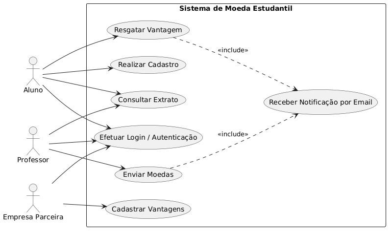
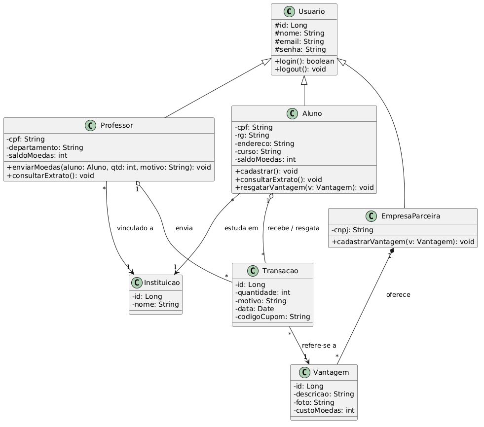
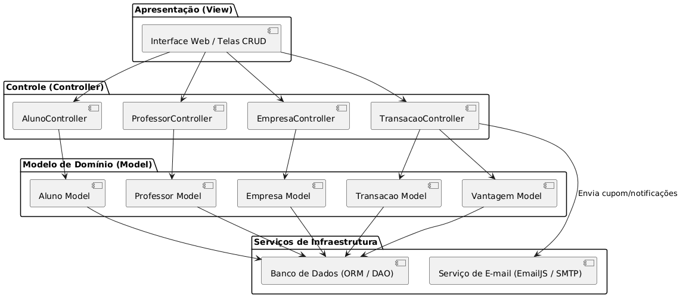

# Sistema de Moeda Estudantil — Laboratório 3

Projeto desenvolvido para a disciplina **Projeto de Software** do Curso de Engenharia de Software da **Pontifícia Universidade Católica de Minas Gerais (PUC Minas)**.

## 📌 Visão Geral do Sistema

O **Sistema de Moeda Estudantil** busca incentivar o reconhecimento do mérito estudantil por meio de uma moeda virtual.

* **Professores** distribuem moedas aos alunos como reconhecimento por participação, bom comportamento e desempenho.
* **Alunos** acumulam moedas e podem trocá-las por produtos, vantagens e descontos oferecidos por **Empresas Parceiras**.
* O projeto adota a arquitetura **MVC (Model-View-Controller)**.

---

## Entregas da Sprint 1 (Lab03S01)

### 1. Histórias do Usuário (User Stories)

* **US01 - Cadastro de Aluno**
  * *Como* aluno, *quero* me cadastrar informando nome, e-mail, CPF, RG, endereço, instituição de ensino e curso, *para* poder ingressar no sistema de mérito estudantil.

* **US02 - Autenticação no Sistema**
  * *Como* usuário (Aluno, Professor ou Empresa Parceira), *quero* realizar login informando e-mail e senha, *para* acessar os recursos restritos da plataforma.

* **US03 - Envio de Moedas por Professor**
  * *Como* professor, *quero* enviar moedas do meu saldo acumulado para um aluno específico informando o motivo (mensagem obrigatória), *para* reconhecer o seu bom desempenho.

* **US04 - Consulta de Extrato (Professor)**
  * *Como* professor, *quero* consultar meu extrato de envio de moedas e verificar meu saldo corrente acumulável (1.000 moedas/semestre).

* **US05 - Consulta de Extrato e Notificação (Aluno)**
  * *Como* aluno, *quero* receber notificações por e-mail a cada nova moeda recebida e consultar meu extrato de saldo, recebimentos e trocas.

* **US06 - Cadastro de Vantagens**
  * *Como* empresa parceira, *quero* cadastrar vantagens com foto, descrição e custo em moedas, *para* disponibilizá-las aos alunos.

* **US07 - Resgate de Vantagens**
  * *Como* aluno, *quero* trocar meu saldo de moedas por uma vantagem cadastrada, *para* receber um cupom por e-mail para resgate presencial.

---

### 2. Modelagem UML

#### Diagrama de Casos de Uso

#### Diagrama de Classes

#### Diagrama de Componentes

---

## Entregas da Sprint 2 (Lab03S02)
