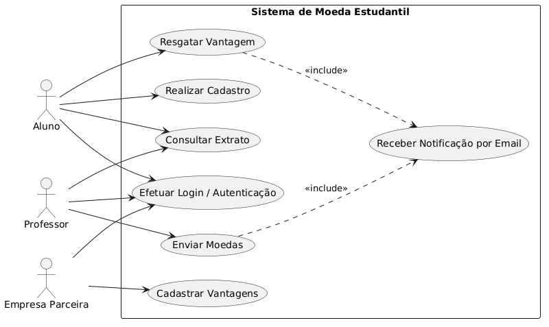
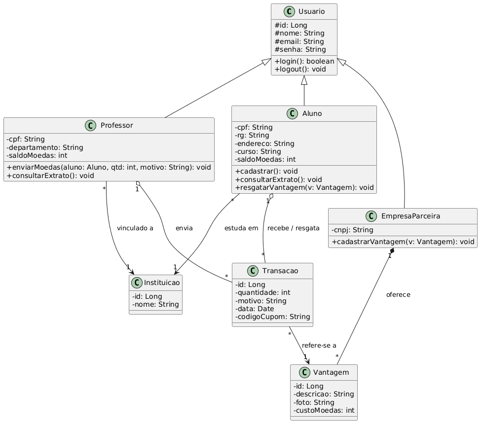
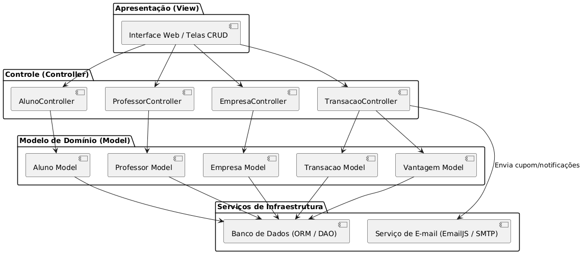

# Sistema de Moeda Estudantil — Laboratório 3

Projeto desenvolvido para a disciplina **Projeto de Software** do Curso de Engenharia de Software da **Pontifícia Universidade Católica de Minas Gerais (PUC Minas)**.

## 📌 Visão Geral do Sistema

O **Sistema de Moeda Estudantil** busca incentivar o reconhecimento do mérito estudantil por meio de uma moeda virtual.

* **Professores** distribuem moedas aos alunos como reconhecimento por participação, bom comportamento e desempenho.
* **Alunos** acumulam moedas e podem trocá-las por produtos, vantagens e descontos oferecidos por **Empresas Parceiras**.
* O projeto adota a arquitetura **MVC (Model-View-Controller)**.

---

## Entregas da Release 01 (Sprints 1 a 3)

### 1. Histórias do Usuário (User Stories)

* **US01 - Cadastro de Aluno**
  * *Como* aluno, *quero* me cadastrar informando nome, e-mail, CPF, RG, endereço, instituição de ensino e curso, *para* poder ingressar no sistema de mérito estudantil.

* **US02 - Autenticação no Sistema**
  * *Como* usuário (Aluno, Professor ou Empresa Parceira), *quero* realizar login informando e-mail e senha, *para* acessar os recursos restritos da plataforma.

* **US03 - Envio de Moedas por Professor**
  * *Como* professor, *quero* enviar moedas do meu saldo acumulado para um aluno específico informando o motivo (mensagem obrigatória), *para* reconhecer o seu bom desempenho.

* **US04 - Consulta de Extrato (Professor)**
  * *Como* professor, *quero* consultar meu extrato de envio de moedas e verificar meu saldo corrente acumulável (1.000 moedas/semestre).

* **US05 - Consulta de Extrato e Notificação (Aluno)**
  * *Como* aluno, *quero* receber notificações a cada nova moeda recebida e consultar meu extrato de saldo, recebimentos e trocas.

* **US06 - Cadastro de Vantagens**
  * *Como* empresa parceira, *quero* cadastrar vantagens com foto, descrição e custo em moedas, *para* disponibilizá-las aos alunos.

* **US07 - Resgate de Vantagens**
  * *Como* aluno, *quero* trocar meu saldo de moedas por uma vantagem cadastrada, *para* receber um cupom por e-mail para resgate presencial.

### 2. Modelagem UML — Sprint 1 (Lab03S01)

#### Diagrama de Casos de Uso


#### Diagrama de Classes


#### Diagrama de Componentes


### 3. Modelo ER e Persistência — Sprint 2 (Lab03S02)
* Definição e mapeamento do esquema relacional contemplando as entidades: `Usuario`, `Aluno`, `Professor`, `EmpresaParceira`, `Instituicao`, `Vantagem` e `Transacao`.
  * 
* Utilização de **Spring Data JPA / Hibernate** para o mapeamento objeto-relacional (ORM), com o padrão de repositórios (`JpaRepository`) para desacoplamento e operações de CRUD seguras.

### 4. Arquitetura e Persistência — Sprint 3 (Lab03S03)
* **Módulo Aluno & Empresa Parceira:** CRUD completo (`AlunoController`, `EmpresaParceiraController`).
* **Módulo Professor & Vantagens:** Professores vinculados a instituições com saldo semestral acumulável; cadastro de vantagens por empresas parceiras.
* **Módulo de Transações:** Envio de moedas (validação de saldo e mensagem obrigatória) e resgate de vantagens com geração automática de código de cupom único.

---

## Entregas da Release 02 (Sprint 4)

### 1. Diagramas de Sequência e Visão Geral de Interação (Lab04S01)
* **Envio de Moedas (Professor → Aluno):**
  * 
* **Resgate de Vantagens (Aluno → Empresa Parceira):**
  * 
* **Diagrama de Visão Geral de Interação:**
  * 

### 2. Diagrama de Implantação e Deploy em Nuvem (Lab04S02)
* 
* Aplicação publicada e com deploy automático a cada push:
  * **App no ar**: https://sistemamoedaestudantil-7khl.onrender.com
  * **Hospedagem**: [Render](https://render.com) (Docker + Postgres gerenciado)
  * **CI**: GitHub Actions roda build e testes (`mvn package`) a cada push/PR na `main`
  * Veja [`deploy-docs/COMO-FUNCIONA.md`](./deploy-docs/COMO-FUNCIONA.md) e [`deploy-docs/TROUBLESHOOTING.md`](./deploy-docs/TROUBLESHOOTING.md)

### 3. Avaliação Cruzada e Refatorações GRASP (Lab04S03)
* **Pendente** — ver seção "O que ainda falta" abaixo.

---

## Tecnologias Utilizadas (Stack)
* **Linguagem:** Java 17 (JDK 17+)
* **Framework:** Spring Boot (Spring Web, Spring Data JPA, Spring Security)
* **Autenticação:** JWT (`JwtUtil`, `JwtAuthenticationFilter`) + senhas com hash **BCrypt**, com login/cadastro alternativo via **Google (Google Identity Services)**
* **Banco de Dados:** PostgreSQL, versionado por **Flyway** (`src/back/db/migration`)
* **Arquitetura:** MVC (Model-View-Controller), com separação em Controllers, Models/Entidades, Repositórios e Serviços

### Configurando o login com Google (opcional em dev)
1. Crie um **OAuth Client ID** do tipo "Web application" no [Google Cloud Console](https://console.cloud.google.com/apis/credentials).
2. Em "Authorized JavaScript origins", adicione `http://localhost:8080` (e a URL do Render em produção).
3. Cole o Client ID na variável `GOOGLE_CLIENT_ID` do seu arquivo `.env` local (veja "Configurar as variáveis de ambiente" abaixo) e rode `.\scripts\load-env.ps1` antes de subir a aplicação. Sem essa variável, o botão "Entrar com Google" simplesmente não aparece — o resto do sistema funciona normalmente.

---

## Como usar / rodar o projeto

> ⚠️ O `pom.xml` define `src/back` como `sourceDirectory` — é esse o código-fonte real do projeto (layout não padrão, diferente do `src/main/java` do Maven), e é lá que ficam `controllers`, `modelos`, `repositorios`, `servicos`, `security`, `evento` e `db/migration`. O front-end estático fica em `src/front`.

### 1. Pré-requisitos
* **JDK 17+** (`java -version`)
* **Maven 3.8+** (`mvn -version`) — ou use o wrapper `mvnw`/`mvnw.cmd`, se presente
* **Docker Desktop** — necessário para subir o banco PostgreSQL localmente

### 2. Subir o banco de dados (PostgreSQL via Docker)
Na raiz do projeto:
```bash
docker compose up -d
```
Isso sobe um container Postgres na porta `5432` (`moedaestudantil`/`moedaestudantil`/`moedaestudantil`), com os dados persistidos em volume Docker. O schema é versionado pelo **Flyway** (`src/back/db/migration`); o Hibernate só valida que as entidades batem com as tabelas (`ddl-auto=validate`).

### 3. Configurar as variáveis de ambiente (senhas, chaves, etc.)
Essas informações (JWT secret, SMTP, Google Client ID) nunca ficam no código nem no Git — cada máquina tem seu próprio arquivo `.env` local:

```powershell
Copy-Item .env.example .env
# edite o .env e preencha os valores reais (veja as seções de e-mail e Google abaixo)
.\scripts\load-env.ps1
```

Rode `.\scripts\load-env.ps1` toda vez que abrir um terminal novo, antes do `mvn spring-boot:run` — ele só carrega as variáveis naquela sessão do PowerShell. O arquivo `.env` está no `.gitignore`: ele nunca é commitado, então depois de clonar o repositório em outra máquina (ou puxar do GitHub de novo), basta repetir esse passo 3 para a aplicação voltar a funcionar.

### 4. Rodando a aplicação
```bash
mvn spring-boot:run
```
Ou, pela IDE (IntelliJ/VS Code com extensão Java), importe como projeto Maven e execute a classe principal (método `main`).

A aplicação sobe em `http://localhost:8080` — abrindo essa URL no navegador aparece o site completo (login, cadastro, dashboards de aluno/professor/empresa). Um `DataSeeder` popula automaticamente instituições, um aluno, um professor, uma empresa parceira e vantagens de exemplo assim que a aplicação sobe.

### 5. Contas de demonstração (senha `123456` para todas)
| Papel | E-mail |
|---|---|
| Aluno | `camila.duarte@puc.br` |
| Professor | `ricardo.alves@puc.br` |
| Empresa parceira | `contato@ru.com.br` |

### 6. Testando os endpoints diretamente (opcional)
```bash
curl http://localhost:8080/api/alunos
curl -X POST http://localhost:8080/api/auth/login -H "Content-Type: application/json" -d "{\"email\":\"camila.duarte@puc.br\",\"senha\":\"123456\",\"tipo\":\"ALUNO\"}"
curl -X POST "http://localhost:8080/api/transacoes/enviar?professorCpf=11111111111&alunoCpf=22222222222&quantidade=100&motivo=Participacao"
```

---

## O que ainda falta (checklist frente ao enunciado)

* [ ] **Avaliação cruzada (Lab04S03).** Falta escolher um projeto de outro grupo da turma e produzir o relatório de análise crítica (arquitetura, organização do GitHub, dificuldade de setup pelo README, erros nos diagramas, erros de alinhamento modelo↔código).
* [ ] **Refatorações GRASP documentadas via PR.** Falta identificar três trechos do próprio código para refatorar segundo padrões GRASP, abrir os Pull Requests no GitHub e documentar no relatório (código antes/depois, padrão aplicado, justificativa).
* [ ] **Repositório GitHub atualizado.** Confirme que todas as versões dos diagramas UML e o código final estão de fato versionados e com histórico no GitHub antes da entrega.

Itens já resolvidos apesar de ainda constarem como "limitação" em versões antigas deste README: autenticação com **JWT + BCrypt** (senha não fica mais em texto puro), banco **PostgreSQL** persistente (não é mais H2 em memória), **e-mail real via SMTP** para notificação de moedas recebidas e cupom de resgate (aluno e empresa parceira), e **upload real de foto** da vantagem (arquivo salvo em disco e servido em `/uploads/**`, configurável por `MAIL_HOST`/`MAIL_USERNAME`/`MAIL_PASSWORD`/`MAIL_FROM` e `UPLOAD_DIR`).
