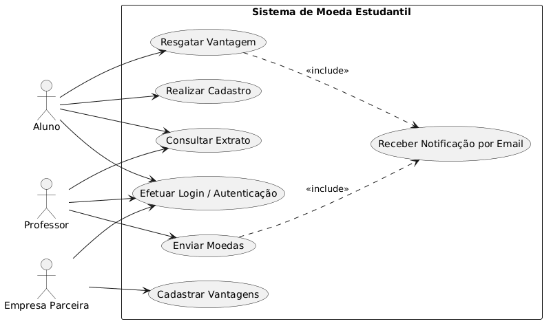
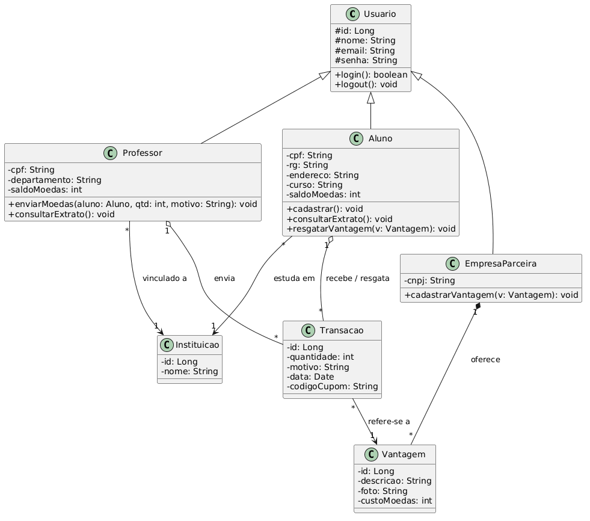
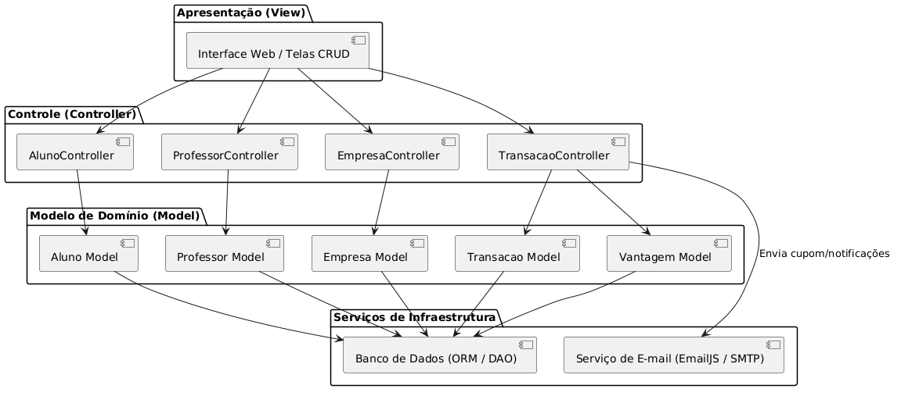

# Sistema de Moeda Estudantil — Laboratório 3

Projeto desenvolvido para a disciplina **Projeto de Software** do Curso de Engenharia de Software da **Pontifícia Universidade Católica de Minas Gerais (PUC Minas)**.

## 📌 Visão Geral do Sistema

O **Sistema de Moeda Estudantil** busca incentivar o reconhecimento do mérito estudantil por meio de uma moeda virtual.

* **Professores** distribuem moedas aos alunos como reconhecimento por participação, bom comportamento e desempenho.
* **Alunos** acumulam moedas e podem trocá-las por produtos, vantagens e descontos oferecidos por **Empresas Parceiras**.
* O projeto adota a arquitetura **MVC (Model-View-Controller)**.

---

## Entregas da Sprint 1 (Lab03S01)

### 1. Histórias do Usuário (User Stories)

* **US01 - Cadastro de Aluno**
  * *Como* aluno, *quero* me cadastrar informando nome, e-mail, CPF, RG, endereço, instituição de ensino e curso, *para* poder ingressar no sistema de mérito estudantil.

* **US02 - Autenticação no Sistema**
  * *Como* usuário (Aluno, Professor ou Empresa Parceira), *quero* realizar login informando e-mail e senha, *para* acessar os recursos restritos da plataforma.

* **US03 - Envio de Moedas por Professor**
  * *Como* professor, *quero* enviar moedas do meu saldo acumulado para um aluno específico informando o motivo (mensagem obrigatória), *para* reconhecer o seu bom desempenho.

* **US04 - Consulta de Extrato (Professor)**
  * *Como* professor, *quero* consultar meu extrato de envio de moedas e verificar meu saldo corrente acumulável (1.000 moedas/semestre).

* **US05 - Consulta de Extrato e Notificação (Aluno)**
  * *Como* aluno, *quero* receber notificações por e-mail a cada nova moeda recebida e consultar meu extrato de saldo, recebimentos e trocas.

* **US06 - Cadastro de Vantagens**
  * *Como* empresa parceira, *quero* cadastrar vantagens com foto, descrição e custo em moedas, *para* disponibilizá-las aos alunos.

* **US07 - Resgate de Vantagens**
  * *Como* aluno, *quero* trocar meu saldo de moedas por uma vantagem cadastrada, *para* receber um cupom por e-mail para resgate presencial.

---

### 2. Modelagem UML

#### Diagrama de Casos de Uso


#### Diagrama de Classes


#### Diagrama de Componentes


---

## Entregas da Sprint 2 (Lab03S02)

### 1. Modelo Entidade-Relacionamento (Modelo ER)
* Definição e mapeamento do esquema relacional contemplando as entidades: `Usuario`, `Aluno`, `Professor`, `Empresa Parceira`, `Instituição`, `Vantagem` e `Transação`.
  * 

### 2. Diagramas de Sequência
* **Envio de Moedas (Professor -> Aluno):**
  * 
* **Resgate de Vantagens (Aluno -> Empresa Parceira):**
  * 

### 3. Estratégia de Acesso ao Banco de Dados e Persistência
* Utilização de **Spring Data JPA / Hibernate** para o mapeamento objeto-relacional (ORM).
* Implementação do padrão de repositórios (`JpaRepository`) para desacoplamento e operações de CRUD seguras.

---

## Entregas da Sprint 3 (Lab03S03)

### 1. Conclusão dos CRUDs e Regras de Negócio
* **Módulo Aluno & Empresa Parceira:** Implementação completa dos endpoints de cadastro, listagem, atualização e remoção (`AlunoController`, `EmpresaParceiraController`).
* **Módulo Professor & Vantagens:** Gestão de professores vinculados a instituições com saldo semestral acumulável e cadastro de vantagens por empresas parceiras.
* **Módulo de Transações:** Lógica de envio de moedas (com validação de saldo e mensagem obrigatória) e resgate de vantagens com geração automática de código de cupom único.

### 2. Tecnologias Utilizadas (Stack)
* **Linguagem:** Java (JDK 17+)
* **Framework:** Spring Boot (Spring Web, Spring Data JPA)
* **Banco de Dados:** H2 / Relacional via ORM
* **Arquitetura:** MVC (Model-View-Controller) com divisão clara entre Controllers, Models e Repositories.

---

## Como usar / rodar o projeto

O projeto já está organizado como um projeto Maven padrão (`pom.xml` na raiz, código em `src/main/java/com/moedaestudantil/...`, front-end estático em `src/main/resources/static/index.html`). A pasta `src/back/` com as classes soltas antigas ficou obsoleta e pode ser apagada quando quiser.

### 1. Pré-requisitos
* **JDK 17+** instalado (`java -version` para conferir)
* **Maven 3.8+** instalado (`mvn -version` para conferir)

### 2. Rodando a aplicação
Na raiz do projeto:
```bash
mvn spring-boot:run
```
Ou, pela IDE (IntelliJ/VS Code com extensão Java), importe o projeto como Maven e execute a classe `SistemaMoedaEstudantilApplication` (método `main`).

A aplicação sobe em `http://localhost:8080` — abrindo essa URL no navegador já aparece o site completo (login, cadastro, dashboards de aluno/professor/empresa), servido pelo próprio Spring Boot. O console do H2 fica em `http://localhost:8080/h2-console` (JDBC URL: `jdbc:h2:mem:moedaestudantil`, usuário `sa`, sem senha).

Como o banco é H2 em memória, os dados somem a cada reinício — mas um `DataSeeder` (`src/main/java/com/moedaestudantil/config/DataSeeder.java`) popula automaticamente algumas instituições, um aluno, um professor, uma empresa parceira e duas vantagens assim que a aplicação sobe, então já dá pra testar o fluxo completo sem cadastrar nada manualmente.

### 3. Contas de demonstração (senha `123456` para todas)
| Papel | E-mail |
|---|---|
| Aluno | `camila.duarte@puc.br` |
| Professor | `ricardo.alves@puc.br` |
| Empresa parceira | `contato@ru.com.br` |

### 4. Testando os endpoints diretamente (opcional)
A interface já cobre o uso normal, mas a API REST continua acessível para quem quiser testar via `curl`/Postman:
```bash
curl http://localhost:8080/api/alunos
curl -X POST http://localhost:8080/api/auth/login -H "Content-Type: application/json" -d "{\"email\":\"camila.duarte@puc.br\",\"senha\":\"123456\",\"tipo\":\"ALUNO\"}"
curl -X POST "http://localhost:8080/api/transacoes/enviar?professorCpf=11111111111&alunoCpf=22222222222&quantidade=100&motivo=Participacao"
```

### 5. Limitações conhecidas (herdadas do escopo acadêmico original)
* Senhas ficam em texto puro no banco (sem hashing) — adequado só para fins didáticos.
* Login não gera token/sessão real no servidor; o front-end guarda o usuário logado no `localStorage` do navegador.
* Não há envio real de e-mail (o enunciado pede notificação por e-mail ao aluno e à empresa parceira — isso ficou como próximo passo).
* Upload de foto da vantagem não foi implementado (campo visual apenas).

---
